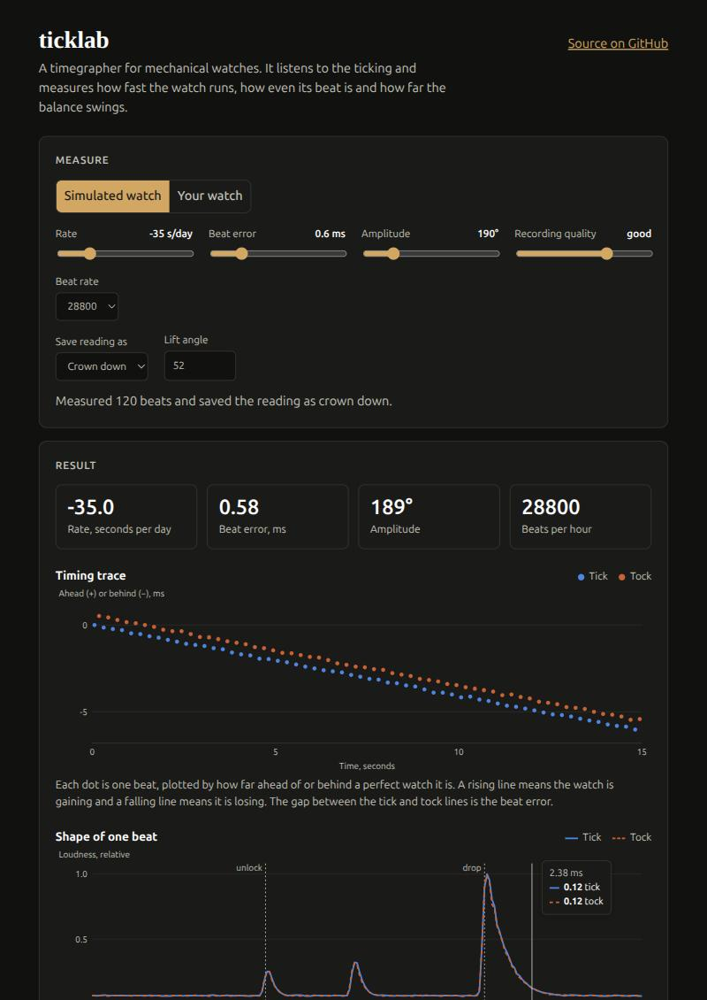

# ticklab

A timegrapher for mechanical watches. Record your watch ticking, and ticklab measures
its **rate** (seconds gained or lost per day), **beat error** and **amplitude**, then
flags problems and, optionally, asks Claude to explain them in plain language.

**[Try the live demo](https://paiyi2go.github.io/ticklab/)**. It runs entirely in your
browser: adjust a simulated watch with sliders, or record or upload your own.

[](https://paiyi2go.github.io/ticklab/)

```
$ ticklab report dial_up=du.wav crown_down=cd.wav
dial_up
  beat rate    28800 bph
  rate         -12.0 s/day
  beat error   1.09 ms
  amplitude    240 deg (lift angle 52)
crown_down
  ...
Average rate -26.5 s/day, positional delta 29.0 s/day
  [warning] Rate varies by 29 s/day between positions, which points to poise or friction problems.
  [warning] Beat error reaches 1.2 ms; the balance is out of beat.
  [warning] Amplitude falls by more than 50 degrees from flat to vertical, suggesting pivot friction or old oil.
```

## Status

The analyser is verified against **synthetic** recordings with known ground truth
(see `tests/`). It has **not yet been validated against real watches or a hardware
timegrapher**. Treat real-world readings as experimental until that is done.

## Install

```bash
pip install -e ".[web,ai,dev]"
```

## Use

```bash
ticklab analyze watch.wav --lift-angle 52          # one recording
ticklab report dial_up=a.wav crown_down=b.wav      # several positions + assessment
ticklab report dial_up=a.wav --ai --movement "ETA 2824-2"   # add Claude's diagnosis
ticklab synth test.wav --rate 8 --beat-error 0.4   # make a synthetic watch
uvicorn ticklab.server:app                         # web demo at http://localhost:8000
python scripts/build_site.py                       # static build of the demo in site/
```

The demo page has two backends. Served by `uvicorn`, it calls the Python API. As a
static site (GitHub Pages), it loads the same Python modules into the browser with
[Pyodide](https://pyodide.org), so no server is needed and recordings never leave the page.

Recordings must be WAV, at least 5 seconds long and sampled at 16 kHz or more.
The `--ai` flag needs an Anthropic API key in `ANTHROPIC_API_KEY`. The web server
only offers AI explanations when started with `TICKLAB_AI=1`, because each one costs money.

## How it works

1. **Envelope.** High-pass at 2 kHz, rectify, smooth over 0.3 ms.
2. **Beat rate.** Autocorrelate the envelope and pick the standard rate
   (18000 to 36000 bph) whose period matches.
3. **Tick timing.** Each tick is three sounds: unlock, impulse and drop. The drop
   is the loudest, so its rising edge is used as the timing reference.
4. **Rate and beat error.** Fit tick times to `t_k = a + T·k + d·(-1)^k`.
   The period `T` gives the rate, `(T_nominal / T - 1) × 86400` s/day, and the
   alternating term gives the beat error, `2|d|`.
5. **Amplitude.** The balance moves as `θ = A·sin(2πft)` and sweeps the lift angle
   `λ` between unlock and drop, so `A = λ / (2·sin(π·f·t_lift))`.
6. **Diagnosis.** `assess()` applies rule-of-thumb thresholds in plain Python.
   `explain()` passes those findings to Claude with a structured-output schema.
   The model interprets the numbers; it never produces them.

On synthetic recordings at 30 dB SNR the analyser recovers rate within 0.5 s/day,
beat error within 0.05 ms and amplitude within 5 degrees. When the faint unlock
pulse is lost in noise it reports no amplitude rather than a wrong one.

## Known limits

- **Sound-card clock error goes straight into the rate.** A typical crystal is off by
  20 to 50 ppm, which is 2 to 4 s/day. There is no calibration step yet.
- **Phone and laptop microphones** may be too quiet without a contact pickup.
- The thresholds in `assess()` are general rules of thumb, not manufacturer specs.
- Lift angle varies by movement; the 52 degree default is wrong for many calibres.

## Roadmap

- Validate against real recordings and a hardware timegrapher.
- Clock calibration against a reference tone.
- Movement database (lift angle, beat rate, known faults).
- Per-watch history and a printable accuracy report.

## License

MIT
